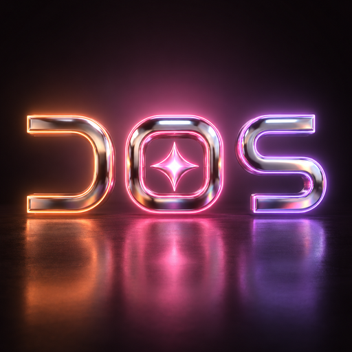

<p align="center">
  
</p>

<h1 align="center">DOS-AutoTube</h1>
<p align="center"><b>The original-content YouTube pipeline behind <a href="https://www.youtube.com/@DOSAIExplained">DOS AI Explained</a></b><br/>
AI &amp; tech, explained simply — researched, scripted, voiced, designed, edited and scheduled by code, approved by a human.</p>

<p align="center">
  
  
  
</p>

---

## What it does

DOS-AutoTube turns **one topic** into a **finished, upload-ready YouTube package**:

| Output | Spec |
|---|---|
| Long video | 1920×1080, H.264 + AAC, 6–10 min, chapters, branded intro sting + end screen |
| Short | 1080×1920, ≤ 60 s, burned-in word-by-word captions |
| Thumbnail | 1280×720, 3–4 bold words, brand gradient, set in code |
| Metadata | title (< 60 chars), description with chapters + sources, 15 tags, hashtags |
| Audio | −14 LUFS integrated, true peak ≤ −1.5 dBTP (YouTube's playback target) |

It is built to make **genuinely original, useful videos** — not mass-produced filler. YouTube demonetises
"inauthentic / repetitive" content, so the pipeline has a quality gate (sources, fact-check, human approval)
baked in rather than bolted on.

## Architecture

```
            ┌────────────┐   ┌────────────┐   ┌────────────┐
 trends ──▶ │ topics.py  │──▶│ script.py  │──▶│ voice.py   │──┐   narration + per-character timing
            └────────────┘   └────────────┘   └────────────┘  │
             Google News US/UK  Gemini / OpenAI   ElevenLabs   │
             + Hacker News      JSON script,      stock voice  │
                                sources, lint     (no cloning) │
                                                               ▼
            ┌────────────┐   ┌────────────┐   ┌────────────────────────┐
            │thumbnail.py│◀──│ visuals.py │──▶│ render.py + edit.py    │──▶ MP4 (long + Short)
            └────────────┘   └────────────┘   └────────────────────────┘
             1280×720 text    3D stills (image   beats timed to the voice,
             in code          API) + code-drawn  Ken Burns motion, sting,
                              cards & diagrams   music bed with ducking,
                                                 loudness, captions (libass)
            ┌────────────┐   ┌────────────┐
            │metadata.py │──▶│ upload.py  │──▶ YouTube (private + publishAt), AI-disclosure flag
            └────────────┘   └────────────┘
                     ▲
       scheduler/config.yaml  (Shorts daily, long videos 2–3×/week, US peak times)
```

**One source of truth per episode:** `episodes/<slug>/script.json` — chapters → beats → *what is said* and
*what is shown*. Every on-screen word comes from the narration of that beat, so text and voice never disagree.

```
dosautotube/
  brand.py      palette (peach #FF9A5A → pink #FF6FA8 → lavender #C9A6FF on #0E0A0D), fonts, logo, image style line
  topics.py     trend research (US/UK Google News + HN), scoring, de-duplication
  script.py     LLM draft (Gemini or OpenAI-compatible), originality + fact rules, lint
  voice.py      ElevenLabs TTS with timestamps, music bed
  visuals.py    image generation + card renderer (title, statement, quote, list, loop, compare, stat, flow, code, end screen)
  edit.py       ffmpeg: Ken Burns, cards, intro sting, concat, mixing/ducking, 2-pass loudnorm, captions
  render.py     timeline from the voice alignment → clips → final MP4
  thumbnail.py  1280×720 thumbnails
  metadata.py   title/description/chapters/tags checks
  upload.py     YouTube Data API v3 upload, thumbnail, scheduling, synthetic-media flag
scheduler/config.yaml   publishing plan + quality gate
episodes/               one folder per video (script + metadata are committed; media is not)
main.py                 CLI
```

## Setup

```bash
git clone https://github.com/Dikshu143644/DOS-AutoTube.git && cd DOS-AutoTube
python -m venv .venv && source .venv/bin/activate
pip install -r requirements.txt
sudo apt-get install ffmpeg        # needs libass (standard builds have it)
cp .env.example .env               # add your keys — .env is git-ignored
```

For API uploads, create an OAuth *Desktop* client in Google Cloud Console (YouTube Data API v3 enabled) and save it
as `.secrets/client_secret.json`. The first upload opens a browser once to authorise; the token is stored in `.secrets/`.

## How to run

```bash
python main.py topics                                    # what's trending in AI for US/UK viewers
python main.py script --topic "How AI agents work" --slug 002-how-ai-agents-work --sources sources.json
python main.py build  --episode episodes/002-how-ai-agents-work
python main.py upload --episode episodes/002-how-ai-agents-work --kind long --publish-at 2026-11-03T14:00:00Z
```

Review `episodes/<slug>/script.json` between `script` and `build` — that is the human checkpoint.

## How scheduling works

`scheduler/config.yaml` is the plan:

| | Cadence | Publish time (ET) | UK | India |
|---|---|---|---|---|
| Shorts | daily | 12:00 PM | 5:00 PM | 9:30 PM |
| Long videos | Tue / Thu (+ Sat) | 9:00 AM | 2:00 PM | 7:30 PM |

1. A scheduled trigger (cron, GitHub Actions, or an assistant's scheduler) runs `python main.py run --kind short|long`
   ahead of the slot (`build_lead_hours`).
2. The run researches topics, drafts the script and builds the video + thumbnail + metadata.
3. The video is uploaded **private with `publishAt`** — YouTube flips it public at the slot. Nothing goes public
   without passing the quality gate; new formats wait for Omkar's OK.

> **Note on API uploads:** YouTube locks videos uploaded through an *unverified* Google Cloud project to private.
> Until the project passes Google's API audit, DOS uploads through YouTube Studio in the browser and uses the
> API code here once verified.

## Quality gate (why this isn't "AI slop")

- Every video answers one real question with an original explanation and a worked example.
- ≥ 2 sources, cited in the description; every on-screen number is spoken and sourced.
- Visuals are made per video (3D stills + code diagrams), not stock loops; ≤ 30 % reuse.
- AI voice and AI visuals are always disclosed (YouTube "altered or synthetic content" + description line).
- A stock narrator voice is used — never a clone of a real person — and is never pitch-shifted.

## Episodes

| # | Video | Status |
|---|---|---|
| 001 | Welcome to DOS AI Explained — AI, Made Simple (channel trailer) | built |
| 002 | How AI Agents Actually Work (Explained Simply) + Short "AI agents are just a loop" | built |

## License

[MIT](LICENSE) © 2026 Omkar Supe / DOS
